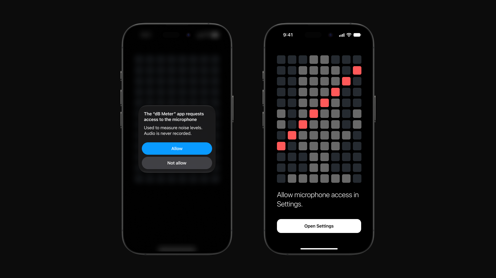
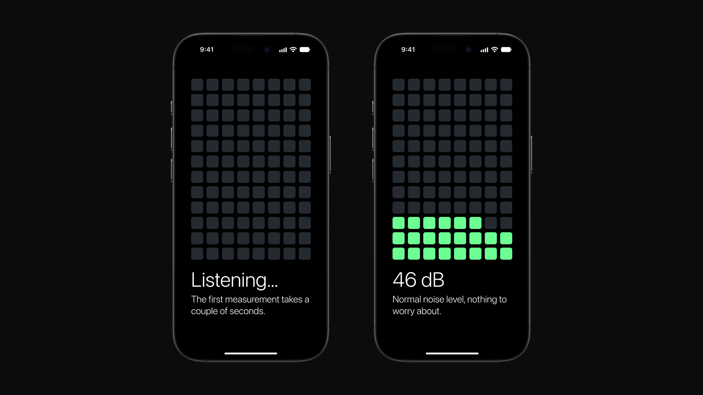
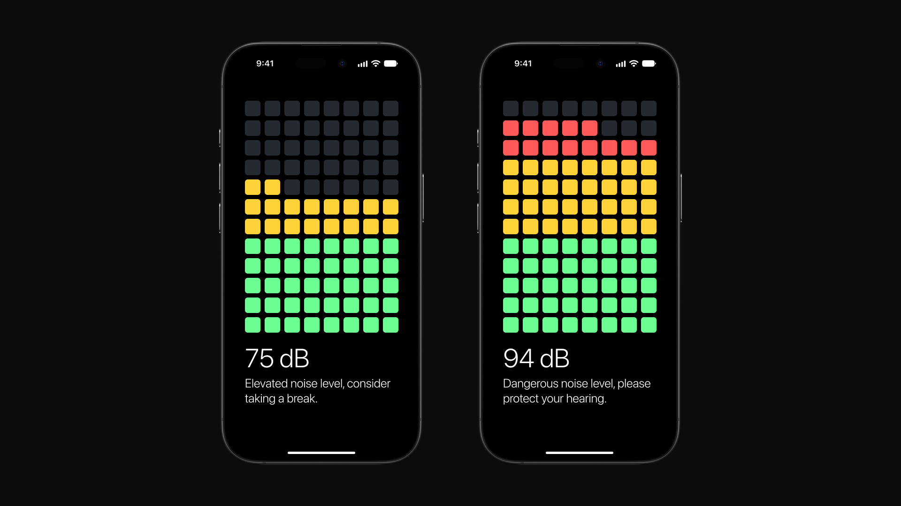
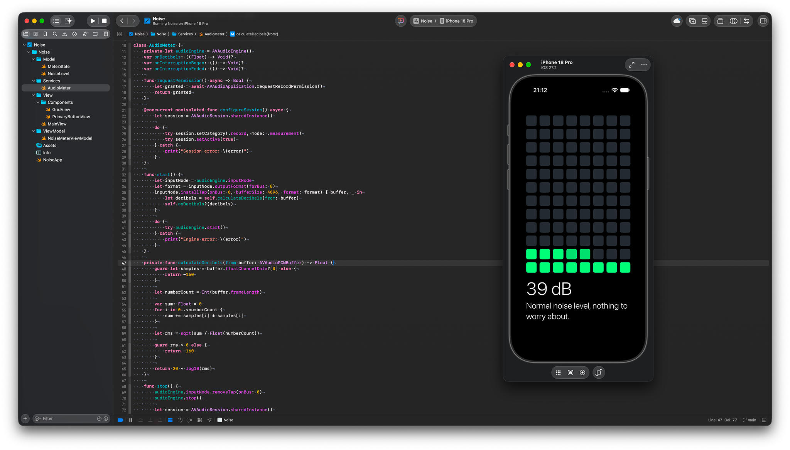

# dB Meter

A minimalist noise meter for iPhone built with SwiftUI. It listens to the microphone in real time, converts the signal to decibels and shows the level on a pixel grid with green, yellow and red zones. Designed in Figma and implemented from scratch as a pet project.

<p align="center">
  
</p>

## Demo

<!-- Video with sound: drag Screenshots/demo.mp4 here when editing README on GitHub -->

## Features

- Real-time noise level from the microphone, about 10 updates per second
- Pixel grid scale 30–102 dB: each row is 6 dB, zones from the same model as the text
- Three levels: normal (< 60 dB), elevated (60–84 dB), dangerous (84+ dB)
- Smoothing and short cell animation for a calm, readable scale
- Microphone permission flow with a custom "denied" screen and a shortcut to Settings
- Stops the microphone when the app goes to background and resumes on return
- Handles audio interruptions: incoming calls, alarms, timers
- Dark theme, portrait orientation, also runs on Apple Silicon Macs

<p align="center">
  
</p>

<p align="center">
  
</p>

## How It Works

```
Microphone → audio tap (4800 samples, ~0.1 s) → RMS → dB → calibration → smoothing → grid
```

1. `AVAudioEngine` delivers audio buffers from the microphone through a tap
2. Each buffer is reduced to one number: the **RMS** (root mean square) of its samples
3. RMS is converted to decibels: `20 × log10(RMS)` — values relative to the microphone maximum (dBFS)
4. A calibration offset maps them to familiar sound levels, then exponential smoothing removes jitter
5. The grid colors every cell by the value it represents on the scale

Phone microphones are not certified measuring instruments, so values are approximate.

## In Xcode

<p align="center">
  
</p>

## Tech Stack

| Area | Tools |
|---|---|
| Language | Swift |
| UI | SwiftUI |
| Architecture | MVVM |
| State | `@Observable`, `@State`, `@Environment` |
| Audio | `AVAudioEngine`, `AVAudioSession` (measurement mode), `AVAudioApplication` |
| Concurrency | `async/await`, `@concurrent` for audio session setup off the main thread |
| Lifecycle | `scenePhase`, interruption notifications via `NotificationCenter` |
| Layout | `LazyVGrid` with fixed cells, adaptive centering |
| Design | Figma |

## Architecture

```
Noise
├── Model
│   ├── NoiseLevel.swift          # Levels, thresholds, colors and descriptions
│   └── MeterState.swift          # Screen states: requesting, denied, listening, measuring
├── Services
│   └── AudioMeter.swift          # Microphone, audio session, dB calculation, interruptions
├── ViewModel
│   └── NoiseMeterViewModel.swift # Start/stop flow, calibration, smoothing
└── View
    ├── MainView.swift            # Screen, grid colors, lifecycle
    └── Components
        ├── GridView.swift        # 8 × 12 pixel grid
        └── PrimaryButtonView.swift
```

## What I Learned

- Working with a system framework from scratch: `AVAudioEngine`, audio taps and audio sessions
- Signal basics: samples, buffers, RMS and the logarithmic decibel scale
- Main thread vs background work, `async/await`, `@concurrent`, `[weak self]` to avoid retain cycles
- Permission flows, app lifecycle and audio interruptions
- Modeling screen states with enums and associated values
- Turning a Figma design into a precise SwiftUI layout

## Requirements

- iOS 17.6+
- Xcode 26+
- A real device is recommended: the simulator uses the Mac microphone

## Getting Started

1. Clone the repository
2. Open `Noise.xcodeproj` in Xcode
3. Select your iPhone and press Run
4. Allow microphone access

## Author

**Valeriy Protsenko** — iOS Design Engineer  
[LinkedIn](https://www.linkedin.com/in/valprotsenko) · [Website](https://lerix.pro/?lang=en) · [Telegram](https://t.me/vallerqq)
